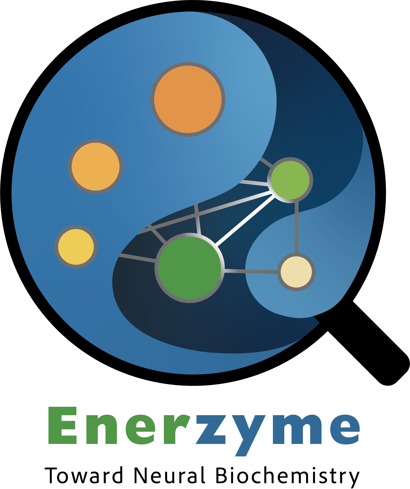

# Enerzyme

<h1>
<p align="center">
    
</p>
</h1>

<a href="https://doi.org/10.5281/zenodo.21018798"></a>

Towards next-generation computational enzymatic catalysis with neural network potentials.

Currently supported model architectures:

|   Model   |   Type   | Energy and force prediction | Charge and dipole prediction | Fully modulized | Shallow ensemble |                                           Reference paper                                           |               Reference code               |
| :-------: | :------: | :-------------------------: | :--------------------------: | :-------------: | :--------------: | :-------------------------------------------------------------------------------------------------: | :----------------------------------------: |
|  PhysNet  | internal |             ✅             |              ✅              |       ✅       |        ✅        | [J. Chem. Theory Comput. 2019, 15 (6), 3678–3693.](https://pubs.acs.org/doi/full/10.1021/acs.jctc.9b00181) | [Github](https://github.com/MMunibas/PhysNet) |
| SpookyNet | internal |             ✅             |              ✅              |       ✅       |        ✅        |          [Nat. Commun. 2021, 12(1), 7273](https://www.nature.com/articles/s41467-021-27504-0)          | [Github](https://github.com/OUnke/SpookyNet) |
|  AlphaNet | internal |             ✅             |         via readout         |       ✅       |   via readout   | [npj Comput. Mater. 2025, arXiv:2501.07155](https://arxiv.org/abs/2501.07155) | [zmyybc/AlphaNet](https://github.com/zmyybc/AlphaNet) checkpoints do not load |
|   MACE   | internal |             ✅             |         via readout         |       ✅       |   via readout   |                   [NeurIPS 2022, arXiv:2206.07697](https://arxiv.org/abs/2206.07697)                   |   [Github](https://github.com/ACEsuit/mace) checkpoints do not load   |
|  BOTNet  | internal |             ✅             |         via readout         |       ✅       |   via readout   | [Nat. Mach. Intell., doi:10.1038/s42256-024-00956-x](https://doi.org/10.1038/s42256-024-00956-x) | [gncs/botnet](https://github.com/gncs/botnet) checkpoints do not load |
| MACE-POLAR-1 | internal |             ✅             | spin charge and dipole |       ✅       |        ❌        | [Batatia et al. 2026](https://github.com/ACEsuit/mace) | [mace](https://github.com/ACEsuit/mace) + [graph_electrostatics](https://github.com/WillBaldwin0/graph_electrostatics); open-boundary GTO, checkpoints do not load |
|   TACE   | internal |             ✅             |         via readout         |       ✅       |   via readout   | [arXiv:2509.14961](https://arxiv.org/abs/2509.14961) / [Cartesian-3j](https://arxiv.org/abs/2512.16882) | [tace](https://github.com/xvzemin/tace) |
|   TECE   | internal |             ✅             |         via readout         |       ✅       |   via readout   | [arXiv:2607.10664](https://arxiv.org/abs/2607.10664) | [tace](https://github.com/xvzemin/tace) |
|   eSCN   | internal |             ✅             |         via readout         |       ✅       |   via readout   | [NeurIPS 2023, arXiv:2302.03655](https://arxiv.org/abs/2302.03655) | [fairchem v1 escn](https://github.com/facebookresearch/fairchem/tree/fairchem_core-1.10.0/src/fairchem/core/models/escn) |
|   eSEN   | internal |             ✅             |         via readout         |       ✅       |   via readout   | [arXiv:2502.12147](https://arxiv.org/abs/2502.12147) | [fairchem v1 esen](https://github.com/facebookresearch/fairchem/tree/fairchem_core-1.10.0/src/fairchem/core/models/esen) |
|  NequIP  | internal |             ✅             |         via readout         |       ✅       |   via readout   |          [Nat. Commun. 2022, 13(1), 2453](https://www.nature.com/articles/s41467-022-29939-5)          | [Github](https://github.com/mir-group/nequip) |
| Allegro | internal |             ✅             |         via readout         |       ✅       |   via readout   |          [Nat. Commun. 2023, 14, 579](https://www.nature.com/articles/s41467-023-36329-y)          | [Github](https://github.com/mir-group/allegro) |
|   UMA   | external |             ✅             |              ✅              |       ✅       |        ❌        | Meta UMA / eSCN-MD checkpoint wrapper (`uma_qs`; not native eSEN) | [fairchem](https://github.com/FAIR-Chem/fairchem) |
| AllScAIP | internal |             ✅             |              ✅              |       ✅       |        ❌        | **Experimental 魔改** — not recommended as a primary model yet | fairchem-inspired |
|  XPaiNN  | external |             ✅             |              ❌              |       ❌       |        ❌        | [J. Chem. Theory Comput. 2024, 20, 21, 9500–9511](https://pubs.acs.org/doi/10.1021/acs.jctc.4c01151) | [Github](https://github.com/X1X1010/XequiNet) |
|  SchNet  | internal |             ✅             |              ✅              |       ❌       |  ✅       |  [NeurIPS 2017, arXiv: 1706.08566](https://arxiv.org/abs/1706.08566) | [Github](https://github.com/pyg-team/pytorch_geometric/blob/master/torch_geometric/nn/models/schnet.py) |
|  PaiNN   | internal |             ✅             |    dipole / polarizability   |       ✅       |   via readout   | [ICML 2021, arXiv:2102.03150](https://arxiv.org/abs/2102.03150) | [SchNetPack](https://github.com/atomistic-machine-learning/schnetpack) |
| ET (TorchMD-NET) | internal |             ✅             |    dipole / polarizability   |       ✅       |   via readout   | [ICLR 2022, arXiv:2202.02541](https://arxiv.org/abs/2202.02541) | [torchmd-net](https://github.com/torchmd/torchmd-net) checkpoints do not load |
| NewtonNet | internal |             ✅             |    dipole / polarizability   |       ✅       |   via readout   | [Digital Discovery 2022, arXiv:2108.02913](https://arxiv.org/abs/2108.02913) | [THGLab/NewtonNet](https://github.com/THGLab/NewtonNet) checkpoints do not load |
|  REANN   | internal |             ✅             | charge dipole / derivative polarizability |       ✅       |   via readout   | [J. Chem. Phys. 2022, 156, 114801](https://doi.org/10.1063/5.0080766) | [zhangylch/REANN](https://github.com/zhangylch/REANN) checkpoints do not load |
| EquiREANN | internal |             ✅             | charge dipole / derivative polarizability |       ✅       |   via readout   | [J. Phys. Chem. A 2024, 128, 11061](https://doi.org/10.1021/acs.jpca.4c06669) | [bjiangch/EquiREANN](https://github.com/bjiangch/EquiREANN) checkpoints do not load |
|  LEFTNet | internal |             ✅             |         via readout         |       ✅       |   via readout   | [NeurIPS 2023, arXiv:2304.04757](https://arxiv.org/abs/2304.04757) | [yuanqidu/LeftNet](https://github.com/yuanqidu/LeftNet) checkpoints do not load |
| TensorNet | internal |             ✅             |      vector via skew       |       ✅       |   via readout   | [NeurIPS 2023, arXiv:2306.06482](https://arxiv.org/abs/2306.06482) | [torchmd-net](https://github.com/torchmd/torchmd-net) checkpoints do not load |
| TensorNet2 | internal |             ✅             | vector via skew; NQE charges |       ✅       |   via readout   | [arXiv:2601.00581](https://arxiv.org/abs/2601.00581) | [torchmd-net](https://github.com/torchmd/torchmd-net) checkpoints do not load |
| EquFlash | internal |             ✅             |         via readout         |       ✅       |   via readout   | SamsungDS GGNN EquFlash | [GGNN](https://github.com/SamsungDS/GGNN) |
|  FACTO   | internal |             ✅             |         via readout         |       ✅       |   via readout   | [arXiv:2611.03276](https://arxiv.org/abs/2611.03276) | no public code; FP32 reference in this repo |
|  GRACE   | internal |             ✅             |         via readout         |       ✅       |   via readout   | [arXiv:2508.17936](https://arxiv.org/abs/2508.17936) | reimplementation; TensorPotential is ASL and is not vendored |
|   CACE   | internal |             ✅             |         via readout         |       ✅       |   via readout   | [npj Comput. Mater. 2024, 10, 157](https://doi.org/10.1038/s41524-024-01332-4) | [cace](https://github.com/BingqingCheng/cace) (CC BY-NC; not vendored) |
| Geodite | internal |             ✅             |         via readout         |       ✅       |   via readout   | [J. Chem. Theory Comput. 2026, doi:10.1021/acs.jctc.6c00712](https://doi.org/10.1021/acs.jctc.6c00712) | [IBM materials](https://github.com/IBM/materials/tree/main/models/pos_egnn/mlip) |
| GemNet-T/Q | internal |             ✅             |         via readout         |       ✅       |   via readout   | [NeurIPS 2021, arXiv:2106.08903](https://arxiv.org/abs/2106.08903) | reimplementation; [gemnet_pytorch](https://github.com/TUM-DAML/gemnet_pytorch) is Hippocratic and is not vendored |
| GemNet-OC | internal |             ✅             |         via readout         |       ✅       |   via readout   | [TMLR 2022, arXiv:2204.02782](https://arxiv.org/abs/2204.02782) | reimplementation of [fairchem ocp2.0 GemNet-OC](https://github.com/facebookresearch/fairchem/tree/ocp2.0/ocpmodels/models); checkpoints do not load |
|  M3GNet  | internal |             ✅             |         via readout         |       ✅       |   via readout   | [Nat. Comput. Sci. 2022, 2, 718](https://doi.org/10.1038/s43588-022-00349-3) | [matgl](https://github.com/materialyzeai/matgl) |
| MatterSim | internal |             ✅             |         via readout         |       ✅       |   via readout   | [arXiv:2405.04967](https://arxiv.org/abs/2405.04967) | M3GNet extended with the paper Graphormer encoder; [mattersim](https://github.com/microsoft/mattersim) v1 checkpoints do not load |
|  CHGNet  | internal |             ✅             |      magmom via readout     |       ✅       |   via readout   | [Nat. Mach. Intell. 2023, 5, 1031](https://doi.org/10.1038/s42256-023-00716-3) | [chgnet](https://github.com/CederGroupHub/chgnet) checkpoints do not load |
|  ALIGNN  | internal |             ✅             |         via readout         |       ✅       |   via readout   | [npj Comput. Mater. 2021, 7, 185](https://doi.org/10.1038/s41524-021-00650-1) | [alignn](https://github.com/usnistgov/alignn) checkpoints do not load |
| SpinConv | internal |             ✅             |         via readout         |       ✅       |   via readout   | [arXiv:2106.09575](https://arxiv.org/abs/2106.09575) | [fairchem ocp2.0 spinconv](https://github.com/facebookresearch/fairchem/blob/ocp2.0/ocpmodels/models/spinconv.py) checkpoints do not load |
| Equiformer | internal |             ✅             |              ✅              |       ✅       |   via readout   | [ICLR 2023, arXiv:2206.11990](https://arxiv.org/abs/2206.11990) | [Github](https://github.com/atomicarchitects/equiformer) |
| EquiformerV2 | internal |             ✅             |         via readout         |       ✅       |   via readout   | [ICLR 2024, arXiv:2306.12059](https://arxiv.org/abs/2306.12059) | [Github](https://github.com/atomicarchitects/equiformer_v2) |
| EquFlashV2 | internal |             ✅             |         via readout         |       ✅       |   via readout   | SamsungDS GGNN EquFlashV2 (e3nn reimplementation; reference code is CC BY-NC-SA) | [GGNN](https://github.com/SamsungDS/GGNN) |
|  Nequix  | internal |             ✅             |         via readout         |       ✅       |   via readout   | [arXiv:2508.16067](https://arxiv.org/abs/2508.16067) | [nequix](https://github.com/atomicarchitects/nequix) |
|  EQNorm  | internal |             ✅             |         via readout         |       ✅       |   via readout   | Chen, Fu, Yang, and Chen, [Matbench Discovery](https://matbench-discovery.materialsproject.org/models/eqnorm-mptrj) | [eqnorm](https://github.com/yzchen08/eqnorm) checkpoints do not load |
| E2Former | internal |             ✅             |         via readout         |       ✅       |   via readout   | [NeurIPS 2025, arXiv:2501.19216](https://arxiv.org/abs/2501.19216) | [E2Former](https://github.com/liyy2/E2Former) |
| E2Former-V2 | internal |             ✅             |         via readout         |       ✅       |   via readout   | [arXiv:2601.16622](https://arxiv.org/abs/2601.16622) | [UBio-MolFM](https://github.com/IQuestLab/UBio-MolFM) |
| E2Former-LSR | internal |             ✅             |         via readout         |       ✅       |   via readout   | [arXiv:2601.03774](https://arxiv.org/abs/2601.03774) | [UBio-MolFM E2Former-LSR](https://github.com/IQuestLab/UBio-MolFM) |
| So3krates | internal |             ✅             |         via readout         |       ✅       |   via readout   | [NeurIPS 2022](https://proceedings.neurips.cc/paper_files/paper/2022/hash/bdcbe343e1768256db0c6480abd226bb-Abstract-Conference.html) | [So3krates-torch](https://github.com/TCPUniLU/So3krates-torch) |
|   SO3LR   | internal |             ✅             |              ✅              |       ✅       |   via readout   | [JACS 2025](https://pubs.acs.org/doi/10.1021/jacs.4c17015) | [so3lr](https://github.com/general-molecular-simulation/so3lr) |
| EFA / SO3LR+EFA | internal |             ✅             |     via readout / SO3LR     |       ✅       |   via readout   | [arXiv:2412.08541](https://arxiv.org/abs/2412.08541) | [euclidean_fast_attention](https://github.com/thorben-frank/euclidean_fast_attention) |
|  DPA4C   | internal |             ✅             |         via readout         |       ✅       |   via readout   | [arXiv:2608.19041](https://arxiv.org/abs/2608.19041) | [deepmd-kit](https://github.com/deepmodeling/deepmd-kit) checkpoints do not load |

Shared equivariant tooling (for developers):

- `enerzyme.models.so3` — SH-array / SPHC primitives (EquiformerV2, So3krates, eSCN-style SO2, TECE), including unified `spherical_harmonics(..., layout=...)`, recursive/direct `WignerD`, `uvSO2Linear` / `SO2Gate` / `ComplexProductBasis`, array dropout, and `SphereSampleReadout`.
- `enerzyme.models.efa` — Euclidean Fast Attention (ERoPE + Lebedev linear nonlocal): SpookyNet `use_efa`, architectures `efa` / `so3lr_efa`, or hook any Core via `EFABlock` / `apply_efa_if_configured` on invariant features + `Ra` + `batch_seg`. Distinct from TECE Radial Rotary Attention.
- `enerzyme.models.e3nn_nn` — flat e3nn Irreps helpers (Equiformer V1, MACE, TACE, TECE, NequIP): TP rescale, Gate/Activation, irreps Linear / ElementLinear, path generation, scatter TP, tools.
- Representation-agnostic blocks: `activation.SmoothLeakyReLU`, `activation.ScaledSigmoid` / `ScaledSiLU`, `blocks.drop` (`GraphDropPath`), `blocks.radial_mlp`.
- `enerzyme.models.layers.gated_equivariant` — Cartesian gated equivariant blocks for tensor heads. PaiNN, NewtonNet, LEFTNet, and AlphaNet store vectors as `atom_vector_feature` with shape `[N, 3, F]`. `EquivariantDipole` and `EquivariantPolarizability` consume that pair.
- `enerzyme.models.local_frame` — local Cartesian frames, local substructure encoding, and frame transitions shared by LEFTNet and AlphaNet.
- `RadialWindow`, `IsolatedAtomResidual`, and `ScreenedZBLRepulsionEnergy` — cutoff envelope, covalent distance weight, isolated-atom residual, and learnable screened ZBL. Geodite uses them outside the Core; later stacks can reuse the same layers.

Architecture packages keep `core.py` + `interaction.py` (plus embedding / input blocks as needed). Equiformer-specific readouts live in each package's `interaction.py` and are re-exported from `layers` for YAML layer-stack discovery.

## Usage

See the Documentation at [ReadTheDocs](https://enerzyme.readthedocs.io/en/latest/) for getting started, user guide, API reference, and developer guide!

### Installation

Recommended environment for internal force fields

```
python==3.13.5
pip==25.2
setuptools==80.9.0
h5py==3.14.0
numpy==2.3.5
addict==2.4.0
tqdm==4.67.1
joblib==1.5.1
pandas==2.3.2
torch==2.8.0
scikit-learn==1.7.1
ase==3.27.0
transformers==4.55.4
torch-ema==0.3
pyyaml==6.0.2
torch-scatter==2.1.2
e3nn==0.5.6
torch-geometric==2.6.1
flask==3.1.2
waitress==3.0.2
```

To test PhysNet, you also need

```
tensorflow==2.13.0
```


To invoke XPaiNN, you need

```
XequiNet==0.3.6
scipy==1.11.2
pyscf==2.7.0
pytorch-warmup==0.1.1
pydantic==1.10.12
```

Then install the package

```bash
pip install -e .
```

### Training

Energy (force) / Atomic Charge / Dipole moment fitting.

```bash
enerzyme train -c <configuration yaml file> -o <output directory>
```

Please see `enerzyme/config/train.yaml` for details and recommended configurations.

Enerzyme saves the preprocessed dataset, split indices, final `<configuration yaml file>`, and the best/last model to the `<output directory>`.

#### Active Learning Training

Please see `enerzyme/config/active_learning_train.yaml` for details and recommended configurations.

### Evaluation

Energy (force) / Atomic Charge / Dipole moment prediction.

```bash
enerzyme predict -c <prediction configuration yaml file> -o <output directory> -m <model directory> -mc <model configuration yaml file>
```

Please see `enerzyme/config/predict.yaml` for details.

Enerzyme reads the `<model directory>` for the model configuration, load the models, predict the results from all active models, save the predicted values as a pickle in the corresponding model subfolders, and report the results as a csv file in the `<output directory>`.

### Simulation

Supported simulation types:

- Constrained optimization. See `enerzyme/config/opt.yaml`
- Constrained flexible scan on the distance between two atoms. See `enerzyme/config/scan.yaml`
- Constrained Langevin MD. See `enerzyme/config/nvt_md.yaml`
- NEB. See `enerzyme/config/neb.yaml`
- Enhanced sampling with plumed. See `enerzyme/config/plumed.yaml`. (Requires py-plumed)

```bash
enerzyme simulate -c <simulation configuration yaml file> -o <output directory> -m <model directory> -mc <model configuration yaml file>
```

Enerzyme reads the `<model directory>` for the model configuration, load the models, do simulation, and report the results in the `<output directory>`.

### Fragment Extraction

Extract fragments based on local uncertainty from the prediction

```bash
enerzyme extract -c <extraction configuration yaml file> -o <output directory> -m <model directory> -mc <model configuration yaml file>
```

Please see `enerzyme/config/extract.yaml` for details.

### Data annotation

Label molecules with energies, forces and dipoles from QM calculation. Please get your QM engine's environment prepared first.

```bash
enerzyme annotate -c <configuration yaml file> -o <output directory> -t <temporary directory> -s <start index> -e <end index>
```

Please see `enerzyme/config/annotate.yaml` for details.

### Bond order assignment

Guess bond orders from pdb file. Compatible with [QuantumPDB](https://github.com/davidkastner/quantumPDB), where the pdb file should be the output of cluster building and the template sdf file should be ligands.sdf.

```bash
enerzyme bond -p <pdb file> -m <output mol file> -i <output image file> -t <template sdf file>
```

### Server mode

Open a server that respond to requests for prediction. It is more powerful to be combined with the [Enerzymette workflow manager](https://github.com/Benzoin96485/Enerzymette).

```bash
enerzyme listen -c <server configuration yaml file> -m <model directory> -o <output directory> -b <bind address> -mc <model configuration yaml file>
```

### Client mode

Send requests to the server for prediction.

```bash
enerzyme request -u <server url> -f <input file format> -i <input file> -k <model key>
```

### Copyright

Copyright (c) 2024-2026, Weiliang Luo, Kulik Group, MIT


#### Acknowledgements
 
Project based on the 
[Computational Molecular Science Python Cookiecutter](https://github.com/molssi/cookiecutter-cms) version 1.11.